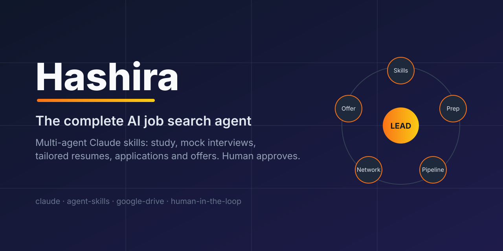
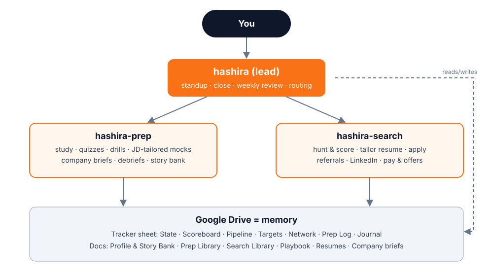
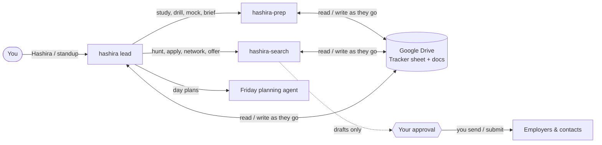
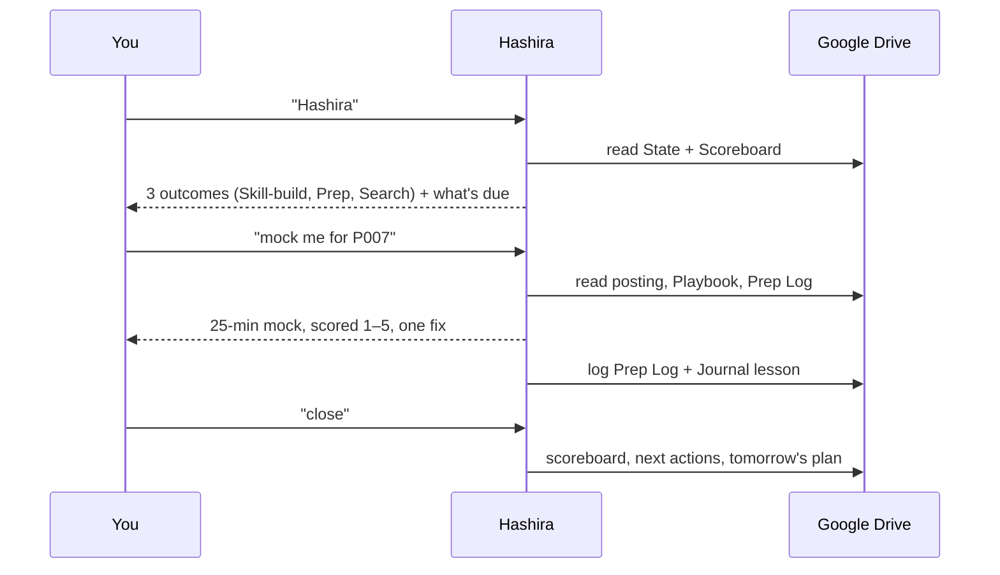

<p align="center">
  
</p>

# Hashira: the complete AI job search agent (Claude skills)

**Hashira is a multi-agent AI job search assistant built from Claude Agent Skills.** One lead agent runs your whole job hunt: daily standups, study plans, mock interviews tailored to a job description, role hunting and fit scoring, tailored resumes and cover letters, referral outreach, and offer negotiation prep. Everything is tracked in Google Drive, and nothing goes out without your approval.

[](LICENSE)
[](https://docs.claude.com)
[](#how-it-works)
[](#safety-and-privacy)
[](https://github.com/Sohanpatro/hashira-the-complete-job-agent/stargazers)

> Built for an **AI Forward Deployed Engineer (FDE)** search, but it works for any software, ML or AI engineering role.

## Contents
- [Why Hashira](#why-hashira)
- [Features](#features)
- [How it works](#how-it-works)
- [Quick start](#quick-start)
- [Usage examples](#usage-examples)
- [Repository layout](#repository-layout)
- [Safety and privacy](#safety-and-privacy)
- [Roadmap](#roadmap)
- [FAQ](#faq)
- [Works with Friday](#works-with-friday)
- [Contributing](#contributing)

## Why Hashira
A job search has five jobs going on at once: learning, interview practice, applications, networking and negotiation. Most people overdo one and neglect the others. Making the plan is the easy part. Following it every day is the hard part.

Hashira (named after the elite "pillars" who lead the fight) works as your **lead**. You talk only to it. It reads your state, picks three outcomes for the day, hands specialist work to its pillar agents, and writes everything back so the next session continues where this one stopped. It doesn't rely on memory between chats.

## Features
| Pillar | What Hashira does |
|---|---|
| 🧠 **Skill-build** | Previews each course module, quizzes you, and schedules spaced revisits |
| 🎤 **Interview prep** | Timed drills (coding, AI system design, customer/decomposition, behavioral, recruiter screen), **mock interviews built from a real job description**, full mock loops, honest 1–5 scoring and debriefs |
| 🔎 **Pipeline** | Hunts roles on company career pages, checks they're still live, scores fit 0–100, checks visa sponsorship, **tailors your resume** and cover letter per role |
| 🤝 **Network** | Finds warm paths, drafts referral asks and recruiter replies, keeps your LinkedIn work quiet |
| 💰 **Close** | Researches pay, compares offers, drafts a negotiation script |
| 📅 **Daily rhythm** | 5-minute standup, 5-minute close, weekly review, and day plans handed to an optional calendar agent |

## How it works





### A day with Hashira


**Design choices that make it reliable**
- **Files are the memory.** One Google Sheet holds everything live (State, Scoreboard, Pipeline, Targets, Network, Prep Log, Journal). Reference docs change rarely.
- **Write as you go.** Every finished unit of work is logged right away, so a session that drops loses nothing.
- **Three outcomes a day, max.** Crowded days fail.

## Quick start
1. **Get the skills.** Clone this repo, or download the three folders in [`skills/`](skills/).
2. **Set up Drive.** Create a "Jobs / Hashira" folder, a Google Sheet with one tab per CSV in [`templates/tracker/`](templates/tracker/), and the docs listed in [`config.example.md`](config.example.md). Start the profile doc from [`templates/profile-and-story-bank.md`](templates/profile-and-story-bank.md). Start the lessons doc from [`templates/lessons-learned.md`](templates/lessons-learned.md) and your master resume from [`templates/resume-template.tex`](templates/resume-template.tex).
3. **Configure and install.** Copy `config.example.env` to `my-config.env`, fill in your IDs, then run:
   ```bash
   scripts/configure.sh my-config.env
   ```
   Upload each folder in `skills.local/` to Claude as a skill, connect Google Drive, and say **"Hashira, run intake."**

## Usage examples
| Say | What happens |
|---|---|
| `Hashira` / `standup` | Today's three outcomes, anything due, and the scoreboard gap |
| `quiz me on RAG evaluation` | 5 questions, feedback, revisit scheduled |
| `mock me for this posting: <link>` | A JD-tailored mock interview, scored against rubrics |
| `hunt` | Up to 5 new, verified, scored roles added to the Pipeline |
| `apply to P004` | Tailored resume, answers and referral ask, ready for your yes |
| `I have an offer` | Offer comparison and a negotiation script |
| `close` / `weekly review` | Logs the day or week and prepares the next |

## Repository layout
```
hashira-the-complete-job-agent/
├── skills/
│   ├── hashira/          # lead orchestrator: standup, close, routing
│   ├── hashira-prep/     # study, drills, mocks, briefs, story bank
│   └── hashira-search/   # hunt, apply, resume, network, LinkedIn, offers
├── templates/
│   ├── tracker/          # one CSV per Google Sheet tab
│   ├── profile-and-story-bank.md
│   ├── lessons-learned.md # standing rules + rejection debrief protocol
│   └── resume-template.tex # single-column LaTeX resume, ATS-readable
├── scripts/configure.sh  # fills {{PLACEHOLDERS}} into skills.local/
├── docs/images/          # banner, architecture, social preview
├── config.example.md / config.example.env
└── CONTRIBUTING.md · CODE_OF_CONDUCT.md · CHANGELOG.md · LICENSE
```

## Safety and privacy
- **Approval before anything leaves.** Hashira drafts and you send. It never submits, posts, messages or deletes without your explicit yes.
- **Truth only.** Resumes and answers use only facts from your profile doc and master resume. It never invents experience.
- **Private by design.** Your current level and pay never appear in any material. Your job search stays confidential: no LinkedIn posts, likes or comments.
- **Your data stays yours.** Your data lives in your own Google Drive. This repo holds only placeholders.

## Roadmap
- [ ] Sample filled-in demo workspace (synthetic data)
- [ ] Prep Library and Search Library doc templates
- [ ] Interview Playbook question bank for AI FDE loops
- [ ] Optional Notion / Excel back end
- [ ] Demo GIF of a standup and a mock interview

## FAQ
**What is an AI Forward Deployed Engineer?** An engineer who works directly with customers to build and deploy AI systems (agents, RAG, evaluations) in their environment. Hashira's prep focuses on the rounds these roles use: customer decomposition, AI system design and practical Python.

**Does Hashira apply to jobs automatically?** No. It finds, scores and prepares everything, but you approve and submit. This is deliberate.

**Which Claude plan do I need?** Any plan that supports Skills and the Google Drive connector.

**Can I use it for non-AI roles?** Yes. Change the target definition and rubrics in your Search and Prep Library docs.

## Works with Friday
Hashira decides each day's study, prep and search blocks. [Friday](https://github.com/Sohanpatro/friday-planning-agent), the AI weekly planning agent, fits them into your real Google Calendar and reports back what fit.

Built by **Sohan Patro**, a software engineer building agentic AI systems. [LinkedIn](https://www.linkedin.com/in/sohanpatro/) · [GitHub](https://github.com/Sohanpatro)

## Contributing
Issues and pull requests are welcome. See [CONTRIBUTING.md](CONTRIBUTING.md). If Hashira helps your search, **⭐ star the repo** so others can find it.

## License
[MIT](LICENSE)
